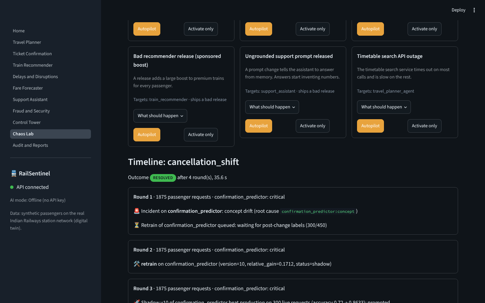
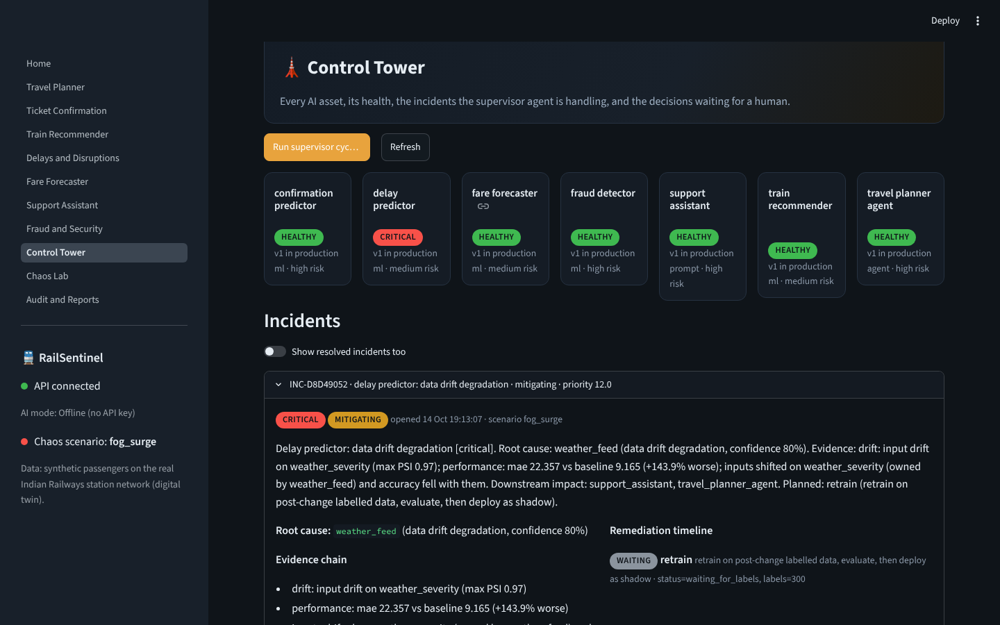
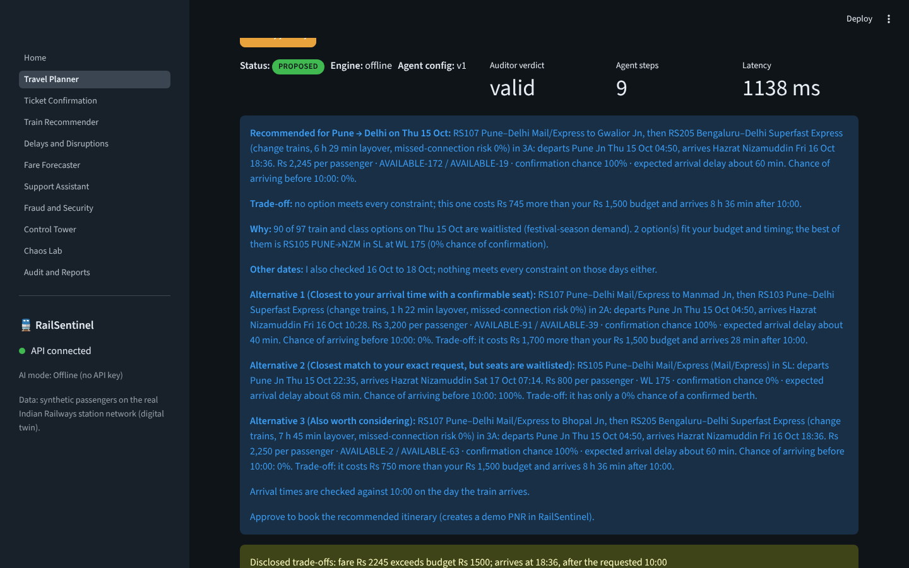
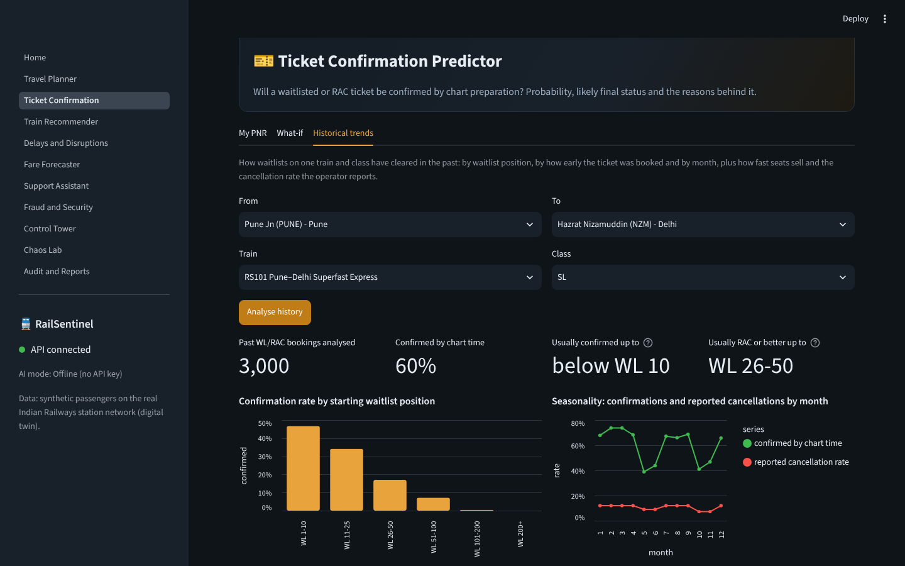
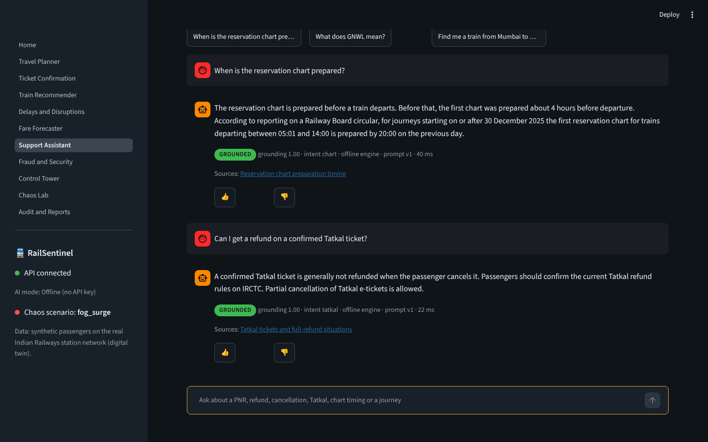
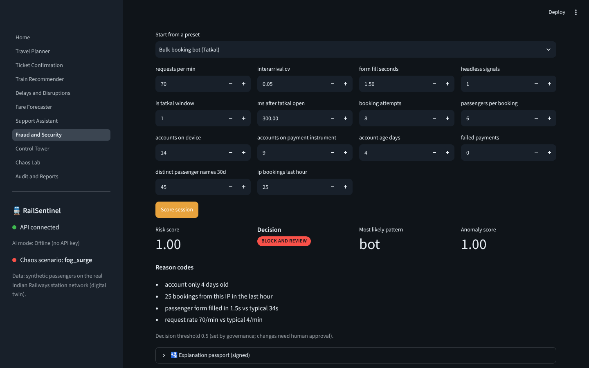
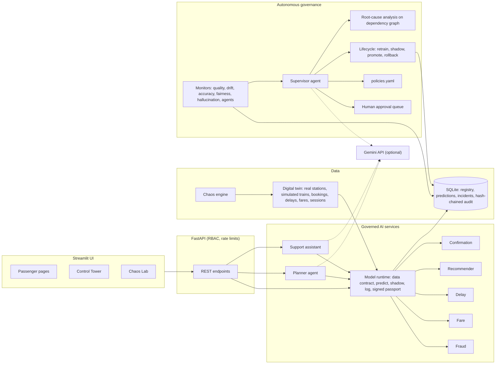
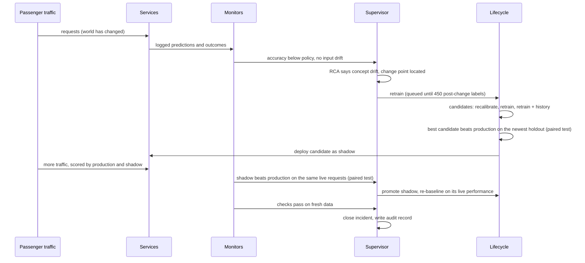

# RailSentinel

**AI rail-travel services, governed in real time by an autonomous AI control tower.**

RailSentinel is an end-to-end platform for the "AI-Powered Intelligent Railway Travel & Autonomous AI Governance"
problem. Passengers get seven AI services: a ticket-confirmation predictor, a smart train recommender, delay and
congestion prediction with proactive alerts, an agentic travel planner, a fare and sell-out forecaster, a grounded
support assistant and a fraud and bot detector. Behind them, a **supervisor agent** monitors every model, prompt and
agent, finds the root cause when something goes wrong, repairs it (retrain and shadow-test, roll back, quarantine a
feed, open a circuit breaker) and asks a human before doing anything that affects passengers. Every step is written
to a tamper-evident audit log.

It runs fully offline on a laptop. Google Gemini is optional: add a free API key and the planner and support assistant
switch to Gemini function calling, with the same audits applied.

 

---

## What makes it different

Most entries for a brief like this build a chatbot and add a monitoring dashboard on the side. RailSentinel flips that:
**the governance layer is the product, and the passenger services are the assets it governs.**

| Idea | Why it matters |
|---|---|
| **Chaos Lab** with 9 realistic failure scenarios | Governance is impossible to demo when nothing goes wrong. Inject dense fog, a corrupted fare feed, stealth booking bots, a bad release, an ungrounded prompt or an API outage, and watch the supervisor detect, diagnose and fix it from evidence alone. |
| **Root-cause analysis on a dependency graph** | The supervisor tells *data drift* from *concept drift* from *a bad deployment* from *a corrupted feed* from *a failing tool*, and picks a different fix for each. It also knows when **not** to act: a festival rush shifts the data without hurting accuracy, so it watches instead of retraining. |
| **Retrain → shadow → promote, decided by statistics** | Retraining waits for enough post-change labels (the change point is located with CUSUM). Three candidates compete: the production model recalibrated on the new labels (keeps what it learned, moves only its output mapping), a model retrained on recent data, and one retrained on recent data plus history. The best must beat production on the newest data, then again on live shadow traffic. "Beat" means a one-sided paired t-test on per-record proper-scoring losses (Brier, pinball, reciprocal rank) and no loss on the headline metric, not a raw accuracy delta. A promoted model is re-baselined on its live performance, so monitors never compare it with the optimistic holdout score it was selected on. |
| **Signed explanation passports** | Every prediction ships with its model version, confidence, Shapley attributions, data-contract result and the model's governance status, signed with HMAC-SHA256. Anyone can verify it later; any edit breaks the signature. |
| **AI agents auditing AI agents** | An auditor re-reads every planner request with an independent parser and checks the agent's proposal against it: no fabricated trains, no silent constraint violations, no booking without approval, no tool-call loops. The same checks apply to Gemini. |
| **Hallucination control that does not trust the model** | Every support answer is checked against its evidence: invented amounts or times are caught by numeric grounding before the answer is logged. |
| **Humans for decisions that affect passengers** | Changing the fraud threshold blocks or unblocks real people, so policy routes it to an approval queue. Low-risk fixes such as rollbacks run automatically. |
| **Honest data** | There is no public dataset of waitlist outcomes or IRCTC bookings. RailSentinel uses the real station network (datameet, CC0) and a documented simulator for everything else, so every number in the demo is reproducible. |

---

## Five-minute demo

1. **Travel Planner** → keep the example *"I want to travel from Pune to Delhi tomorrow under ₹1500 and reach before 10:00 AM."* and press **Plan my journey**. Show the agent trace (search, availability, confirmation, delay, ranking, date-flex and fare agents) and the auditor verdict. When no train meets every constraint (the twin's festival season runs from mid-October to mid-November, so most trains are waitlisted), the agent says why, quantifies each trade-off ("Rs 745 over budget, arrives 8 h 36 min after 10:00"), checks the next three days and offers the option closest to your deadline. Approve to create a demo PNR.
2. **Ticket Confirmation** → pick a waitlisted demo PNR. Open the **explanation passport**, click **Verify signature**. Then open **Historical trends** to see how far this train's waitlists usually clear.
3. **Support Assistant** → ask *"How much refund if I cancel PNR …?"* and *"Can I get a refund on a confirmed Tatkal ticket?"*. Note the grounding badge and the official sources.
4. **Chaos Lab** → **Autopilot** on *Corrupted fare feed* (about 15 s: blocked at the contract, traced to `fare_feed`, quarantined, verified). Then *Bad recommender release* (rolled back automatically) and *Passengers stop cancelling* (concept drift: waits for post-change labels, the recalibrated model beats both retrained candidates on the holdout, wins again on live shadow traffic, promoted; about 40-60 s).
5. **Chaos Lab** → **Autopilot** on *Genuine Tatkal rush flagged as bots*. It stops at **awaiting human approval**. Open the **Control Tower**, approve, and watch the threshold change and the incident close.
6. **Audit & Reports** → verify the hash chain and download the governance report (model cards, incidents, ethics checks, NIST AI RMF mapping).

The same flows run from the command line: `python scripts/run_scenario.py fog_surge`.

### Screenshots

These are captured from the running app (offline mode, no API key).

| | |
|---|---|
|  **Chaos Lab:** concept drift detected, retrain queued until enough labels, shadow promoted, verified |  **Control Tower:** fog incident traced to `weather_feed` with the evidence chain and the remediation plan |
|  **Travel planner:** quantified trade-offs, reasons, nearby dates and purposeful alternatives |  **Confirmation trends:** how far this train's waitlists usually clear |
|  **Support assistant:** grounded answers with sources and a live grounding grade |  **Fraud detector:** risk score, decision and investigator-readable reason codes |

---

## Requirement coverage

| Brief requirement | Where it lives |
|---|---|
| 1. Ticket confirmation predictor: probability, final status, trends, confidence, explainability, auto-retrain | `railsentinel/ml/confirmation.py` (gradient boosting, CNF/RAC/WL probabilities), Shapley passport, historical booking and cancellation trends per train and class (`core.py` `confirmation_trends`, `GET /insights/confirmation-trends`), `governance/lifecycle.py` |
| 2. Smart recommender: budget, duration, availability, class, history, punctuality, preferences; relevance, bias, rationale, optimisation | `ml/recommender.py` (pairwise choice model), hit@1/MRR monitors, segment parity + premium-exposure bias, per-option rationale, retraining from feedback |
| 3. Delay and disruption: arrival/departure delay, station congestion, proactive alerts, alternatives, confidence, drift, retraining | `ml/delay.py` (quantile models p10/p50/p90), `core.py` (`station_congestion`, `journey_alerts`) |
| 4. Travel planner agent: conversation, search, optimisation, best itinerary, booking after approval, multi-agent coordination; validation, monitoring, audit trail, abnormal behaviour | `agents/planner.py`, `agents/tools.py` (direct and one-change itineraries with missed-connection risk), `governance/agent_audit.py` |
| 5. Dynamic fare engine: fare movement, demand surges, booking window, cost saving; accuracy, pricing anomalies, explanations | `ml/fare.py` (occupancy quantiles + sell-out classifier, flexi-style pricing), quote-anomaly check, `core.py` (`fare_forecast` with `demand_outlook`: forecast demand against the train's usual level flags surges) |
| 6. Support assistant: PNR, booking, refunds, cancellation, recommendations, planning; hallucinations, quality, satisfaction, auditability | `agents/support.py`, `governance/hallucination.py`, feedback-based CSAT, PII-masked conversation logs |
| 7. Fraud and bots: bulk bots, suspicious transactions, account misuse, anomalies, risk scores; FP/FN monitoring, model updates, explainable alerts | `ml/fraud.py` (classifier + Isolation Forest, reason codes), FPR/FNR monitors, retraining and threshold recalibration |
| 8. Governance: health/SLA/resources, data quality, data and concept drift, behaviour change, bias, hallucination, ethics checks, RCA, lifecycle, explainability, reports, audit, supervisory agents | `governance/` (monitors, stats, rca, lifecycle, supervisor, policies.yaml, audit, reports, chaos) |
| Non-functional: security (RBAC, privacy, threat monitoring), reliability, compliance, performance | API keys per role, rate limiting with audit, PII masking, HMAC passports, hash-chained audit, circuit breakers and feed failover, data contracts, verified backups and restore (`scripts/backup.py`), measured serving performance (`scripts/benchmark.py`) |

---

## Architecture



The closed governance loop, as it runs during the *cancellation shift* scenario:



**Design choices**

* *Policy decides, the LLM explains.* Remediations come from evidence and `policies.yaml`. When Gemini is configured it writes the incident narrative; it never chooses the action.
* *Verification on fresh data.* After any fix, monitors only judge data produced after it (a per-asset window floor), so an incident closes only when the checks that opened it pass again.
* *Separation of traffic.* Calls the planner makes on a passenger's behalf are logged as agent traffic: watched for health, excluded from the passenger distributions used for drift and accuracy.
* *Statistics before action.* An autonomous system that acts on noise is worse than none. Drift alerts need a large shift (PSI) that is also significant (KS or chi-square) and either severe or persistent across two cycles; fairness alerts judge only groups with at least 50 outcomes, test each group against the rest with a Bonferroni correction and must persist across two cycles; a fraud false-positive rate above its limit counts only when a binomial test says it is significantly above; root-cause analysis only blames a release that is still serving; model swaps need a paired significance test. Each rule was added after measuring false alarms in repeated chaos runs.

---

## Tech stack

| Layer | Tools |
|---|---|
| Models | scikit-learn `HistGradientBoostingClassifier` / `Regressor` (including quantile loss), `IsolationForest`, `LogisticRegression` (pairwise choice model; recalibration layer for adapted models) |
| Explainability | Monte Carlo Shapley values (model-agnostic, exactly additive per sample) implemented in `ml/explain.py` |
| Drift and change detection | PSI, two-sample Kolmogorov-Smirnov (SciPy), Page-Hinkley, CUSUM change point |
| Model comparison | One-sided paired t-test (SciPy) on per-record Brier, pinball and reciprocal-rank losses, with a non-inferiority check on the headline metric |
| Agents | Google Gen AI Python SDK (`google-genai`, Gemini function calling), deterministic fallbacks |
| Retrieval | TF-IDF retrieval (scikit-learn) over a small, sourced policy knowledge base |
| API | FastAPI, Uvicorn, Pydantic |
| UI | Streamlit, Altair |
| Storage | SQLite (WAL mode), joblib artifacts |
| Ops | Docker, Docker Compose, Hugging Face Spaces (Docker) |

---

## What is real and what is simulated

| Real | Simulated by the digital twin |
|---|---|
| 70 Indian Railways stations with coordinates ([datameet/railways](https://github.com/datameet/railways), CC0) | Trains (numbered `RS101`… so they never clash with real train numbers), timetables, fares, seat inventory |
| Cancellation and refund rules ([indianrail.gov.in](https://www.indianrail.gov.in/refund_Rules.html), revised w.e.f. 12.11.2015) | Waitlist outcomes, delays, weather, occupancy and fare movements |
| Reported reservation-chart timing changes (2025) and Tatkal refund exceptions (cited in the knowledge base) | Passengers, booking sessions, bots, fraud |

The simulator is documented in `railsentinel/twin/generators.py`: waitlists clear through cancellations, delays build up
along a route with weather and congestion, bots act faster than people. Baseline model quality on twin data (held-out
20%): confirmation accuracy about 0.91, delay MAE about 9 minutes, occupancy MAE about 0.044, fraud recall about 0.99,
recommender hit@1 about 0.35 among about 16 options. These describe the simulator, not Indian Railways.

---

## Run it locally

**Requirements:** Python 3.11, 3.12 or 3.13, about 1 GB of free RAM, and 2-3 minutes for the first setup.

```bash
git clone https://github.com/mimaniharsh/railsentinel.git
cd railsentinel
python -m venv .venv
source .venv/bin/activate            # Windows: .venv\Scripts\activate
pip install -r requirements-dev.txt
cp .env.example .env                 # optional; Windows: copy .env.example .env
python scripts/bootstrap.py          # trains 5 models, seeds demo PNRs, warms up monitors (about a minute)
```

Start the API and the UI in two terminals (both with the virtual environment active):

```bash
uvicorn railsentinel.api.main:app --port 8000
```

```bash
streamlit run ui/Home.py
```

Open **http://localhost:8501** for the UI and **http://localhost:8000/docs** for the interactive API docs.

If you skip `bootstrap.py`, the API bootstraps itself on first start. On a slow machine use
`python scripts/bootstrap.py --reset --scale 0.4` for smaller training sets. `make install bootstrap api ui` does the same on macOS and Linux.

### With Docker

```bash
docker compose up --build
```

UI on http://localhost:8501, API on http://localhost:8000. Models are trained during the image build, and the data
directory lives in the `rs-data` volume.

### Enable Gemini (optional, free key)

1. Create a free API key in Google AI Studio: https://aistudio.google.com/apikey (no billing needed for the free tier).
2. Put it in `.env`:

   ```
   GEMINI_API_KEY=your-key-here
   RS_LLM_MODEL=gemini-3.8-flash
   ```

3. Restart the API. The planner and support assistant now use Gemini function calling; the sidebar shows the AI mode.

Simulated passenger traffic stays on the offline engines unless you set `RS_LLM_FOR_SYNTHETIC_TRAFFIC=true`, which
keeps the demo inside the free tier's request limits. If a Gemini call fails (quota, network, invalid key), the
planner and support assistant fall back to the offline engines for that request. On the free tier Google may use
prompts and responses to improve its products (see the Gemini API pricing and terms pages); every passenger in this
demo is simulated, so no real personal data is sent.

---

## Configuration

All settings are environment variables (see `.env.example`):

| Variable | Default | Purpose |
|---|---|---|
| `GEMINI_API_KEY` | empty | Enables Gemini for the planner, support assistant and incident narratives |
| `RS_LLM_MODEL` / `RS_LLM_JUDGE_MODEL` | `gemini-3.8-flash` / `gemini-3.5-flash-lite` | Models for agents and for the optional faithfulness judge |
| `RS_API_KEYS` | demo keys | `role:key` pairs; roles are `passenger`, `operator`, `admin` |
| `RS_PASSPORT_SECRET` | demo secret | HMAC key for explanation passports |
| `RS_SUPERVISOR_INTERVAL` | `45` | Seconds between supervisor cycles inside the API (0 disables) |
| `RS_BACKGROUND_TRAFFIC` | `true` | Simulate passenger traffic before each cycle |
| `RS_DATA_DIR` | `./data` | Database and model artifacts |
| `RS_BOOTSTRAP_SCALE` | `1.0` | Training-set size multiplier |
| `RS_API_URL` / `RS_UI_API_KEY` | `http://localhost:8000` / admin demo key | How the UI reaches the API |

**Change the demo keys and the passport secret before exposing the API publicly.**

---

## Using the API

Every endpoint is documented at `/docs`. A few examples:

```bash
# Plan a journey (passenger key)
curl -s -X POST localhost:8000/agent/plan -H "X-API-Key: rs-passenger-demo" -H "Content-Type: application/json" \
  -d '{"query": "I want to travel from Pune to Delhi tomorrow under ₹1500 and reach before 10:00 AM."}'

# How far do waitlists on RS101 Sleeper usually clear? (historical trends)
curl -s "localhost:8000/insights/confirmation-trends?train_number=RS101&travel_class=SL" -H "X-API-Key: rs-passenger-demo"

# Ask the support assistant
curl -s -X POST localhost:8000/support/chat -H "X-API-Key: rs-passenger-demo" -H "Content-Type: application/json" \
  -d '{"message": "Can I get a refund on a confirmed Tatkal ticket?"}'

# Fleet status (operator key) and audit-chain check
curl -s localhost:8000/gov/fleet -H "X-API-Key: rs-operator-demo"
curl -s localhost:8000/gov/audit/verify -H "X-API-Key: rs-operator-demo"

# Run a chaos scenario end to end (admin key)
curl -s -X POST localhost:8000/chaos/autopilot -H "X-API-Key: rs-admin-demo" -H "Content-Type: application/json" \
  -d '{"scenario": "fare_feed_glitch"}'
```

| Role | Can do |
|---|---|
| passenger | predictions, recommendations, planner, support, PNR lookup and cancellation, fraud scoring |
| operator | everything above plus reading fleet status, incidents, audit trail, reports, logs |
| admin | everything above plus approvals, promote/rollback/retrain, running the supervisor, chaos scenarios |

---

## Chaos scenarios

| Scenario | What breaks | Detected by | Diagnosis | Remediation |
|---|---|---|---|---|
| `fog_surge` | Weather severity jumps and causes twice the delay | Drift on `weather_severity`, delay MAE up | Data drift from `weather_feed` | Recalibrate or retrain on post-change data → shadow → promote |
| `cancellation_shift` | Passengers cancel far less; inputs look unchanged | Accuracy drop, no input drift | Concept drift (CUSUM change point) | Recalibrate or retrain (best on holdout) → shadow → promote |
| `festival_rush` | Festival demand everywhere | Input drift, accuracy stable | Benign shift | Watch, do not retrain |
| `fare_feed_glitch` | 25% of fare quotes are 0, negative or 10-25x | Data contracts block, quote anomalies | Corrupted `fare_feed` | Quarantine feed, serve backup, release after probes |
| `stealth_bots` | Bots copy human pacing and rotate cards/IPs | Recall collapses (false negatives) | Adversary adaptation | Retrain on investigated sessions → shadow → promote |
| `tatkal_rush_false_positives` | Genuine Tatkal rush looks bot-like | False-positive rate above policy | Behaviour change | Threshold change **after human approval**, re-baseline |
| `recommender_bad_release` | Release boosts premium trains for everyone | Exposure bias, relevance drop after a deploy | Deployment regression | Automatic rollback |
| `prompt_regression` | Prompt release drops grounding rules | Hallucination rate spikes after a deploy | Prompt regression | Automatic rollback |
| `search_api_outage` | Timetable search times out | Agent tool errors and retry loops | Failing dependency | Circuit breaker to cached timetable, closed after probes |

In offline mode the `prompt_regression` release reproduces an ungrounded prompt by rewriting numbers in answers
(clearly marked in `agents/support.py`), so the hallucination monitor has something real to catch. With Gemini
enabled, the faulty prompt is sent to Gemini as is.

---

## Tests

```bash
pytest -m "not slow"   # 49 fast tests, about 1-2 minutes
pytest                 # adds 9 end-to-end chaos scenarios, about 6 minutes in total
python -m pyflakes railsentinel ui scripts tests   # lint (make lint)
```

Coverage includes the refund rules, request parsing, Shapley additivity, PSI/Page-Hinkley/CUSUM, the paired
model-comparison test, hallucination detection, passport signatures, PII masking, the audit hash chain, backup
verification and restore (including a tampered backup being refused), every model's contract and passport, the
planner (offline, with a scripted Gemini client built from the real SDK response types, and falling back offline when
Gemini fails, including an auditor catching a fabricated train), the Gemini function-calling loop driven through the
real `google-genai` client over a mocked network (request format, thought signatures, function results, errors), the
support assistant, RBAC and API endpoints (including historical trends and demand
outlook), and every chaos scenario end to end.

---

## Reliability, backups and performance

**Backups and restore (disaster recovery).**

```bash
python scripts/backup.py create                                        # safe while the API is running
python scripts/backup.py verify  backups/railsentinel-<timestamp>
python scripts/backup.py restore backups/railsentinel-<timestamp>      # stop the API first
```

A backup holds a consistent SQLite online-backup snapshot, every model artifact, and a manifest with SHA-256
checksums, the audit-chain head and the production version of every asset. `verify` re-checks the checksums and
the audit hash chain inside the backup. `restore` refuses a backup that fails either check, and moves the current
data directory aside instead of deleting it.

**Fault tolerance.** Data contracts block bad records before inference. A quarantined feed fails over to its backup
source. A failing tool trips a circuit breaker to the cached timetable. When Gemini is unreachable or over its quota, the
planner and support assistant fall back to the offline engines. A monitor that crashes does not stop the other monitors or the
supervisor loop.

**Measured serving performance** (`python scripts/benchmark.py`). Each figure covers the full serving path (data
contract, model, prediction log, signed passport) on one CPU thread, measured in a 2-vCPU Linux container with
Python 3.13:

| Service | Single request p50 | p95 | Batched throughput |
|---|---|---|---|
| Confirmation predictor | 19 ms | 27 ms | about 2,000 predictions/s |
| Train recommender (about 16 options per request) | 1 ms | 2 ms | about 1,100 requests/s |
| Delay predictor (three quantile models) | 37 ms | 53 ms | about 2,800 predictions/s |
| Fare forecaster (four models) | 53 ms | 71 ms | about 2,600 predictions/s |
| Fraud detector (classifier and Isolation Forest) | 36 ms | 55 ms | about 870 sessions/s |
| Planner agent, offline engine | 203 ms | 237 ms | - |
| Support assistant, offline engine | 15 ms | 26 ms | - |

Unbatched, one worker thread serves about 50 confirmation predictions a second (about 4.5 million a day at full
load); batched, about 170 million a day per core. The API keeps no request state outside the database, so capacity
grows with worker processes, but this repository runs one process on SQLite (see Limitations). The planner takes
about a second when nothing meets every constraint, because it also searches the next three days. Run the script on
your own machine; `--api http://localhost:8000` also times real HTTP round trips.

---

## Deploy

### Hugging Face Spaces (CPU hardware is enough)

1. Create a new Space, choose **Docker** as the SDK.
2. Push this repository to the Space, replacing `README.md` with `deploy/huggingface/README.md` (it carries the Space metadata, including `app_port: 8501`):
   ```bash
   git clone https://huggingface.co/spaces/<your-user>/railsentinel hf-space
   rsync -a --exclude .git ./ hf-space/ && cp deploy/huggingface/README.md hf-space/README.md
   cd hf-space && git add . && git commit -m "Deploy RailSentinel" && git push
   ```
3. Optional: add `GEMINI_API_KEY`, `RS_API_KEYS` and `RS_PASSPORT_SECRET` as Space secrets (they arrive as environment variables).

The container runs `scripts/start.sh`: the API on an internal port and the UI on the public one. Space storage is
ephemeral, so the demo resets to its trained state when the Space restarts.

### Any Docker host

```bash
docker build -t railsentinel .
docker run -p 8501:8501 -e GEMINI_API_KEY=... railsentinel
```

---

## Push to GitHub

**With GitHub Desktop (Windows or macOS):**

1. File → **Add local repository…** → choose the `railsentinel` folder (the one with this README).
2. It reports that the folder is not a Git repository yet: click **create a repository**, keep the name
   `railsentinel`, leave README, Git ignore and License as they are, and click **Create repository**. GitHub Desktop
   makes the first commit with every file `.gitignore` allows (no `.venv`, `data` or `.env`).
3. Click **Publish repository**, untick **Keep this code private** if judges or reviewers need to see it, and publish.

**From the command line** (create an empty `railsentinel` repository on GitHub first, with no README, licence or
.gitignore, since they are included):

```bash
cd railsentinel
git init
git add .
git commit -m "RailSentinel: AI rail travel with autonomous AI governance"
git branch -M main
git remote add origin https://github.com/mimaniharsh/railsentinel.git
git push -u origin main
```

With the GitHub CLI, the repository can be created and pushed in one step:
`gh repo create mimaniharsh/railsentinel --public --source=. --push`.

---

## Project structure

```
railsentinel/
├── railsentinel/
│   ├── config.py, db.py, security.py, core.py, traffic.py, backup.py
│   ├── data/                  stations.csv (datameet, CC0), corridors.yaml, knowledge/ (sourced policy notes)
│   ├── twin/                  network, seasons, world state, inventory, generators, live feeds, bookings
│   ├── ml/                    model specs (5 models), data contracts, Shapley explainer, serving runtime
│   ├── agents/                LLM wrapper, request parser, journey tools, planner, support, refunds, retrieval
│   ├── governance/            monitors, stats, rca, lifecycle, supervisor, policies.yaml, audit, reports, chaos
│   └── api/                   FastAPI app and request schemas
├── ui/                        Streamlit app (Home + 10 pages)
├── scripts/                   bootstrap, run_scenario, backup, benchmark, export_samples, fetch_station_data, start.sh
├── sample_data/               small samples of every twin dataset and the generated timetable
├── tests/                     pytest suite
├── deploy/huggingface/        Space metadata README
├── docs/screenshots/          screenshots used in this README
├── Dockerfile, docker-compose.yml, Makefile, requirements*.txt, pyproject.toml, .env.example, LICENSE
```

---

## Limitations

* All passenger, train, delay, fare and fraud data is simulated. Real deployment needs historical Indian Railways data
  (for example from CRIS/IRCTC) and recalibrated models; the governance layer would carry over unchanged.
* Single-node SQLite keeps setup to one command. For production scale, the stateless API scales horizontally and the
  storage layer would move to PostgreSQL and a proper model store; that has not been built here.
* Refund and chart rules are quoted with their dates and sources. Rules change: always confirm on IRCTC.
* RailSentinel is an independent project, not affiliated with Indian Railways or IRCTC. Demo PNRs exist only in its
  own database.
* The fairness checks compare outcomes across operational segments in the simulator (regions, account tenure,
  traveller types). They demonstrate the mechanism; real fairness audits need real data and domain review.
* The support assistant and planner work in English only (a deliberate scope choice for this version). The
  hallucination checks and the offline intent routing are tuned for English text.

## Licence and attribution

MIT, see `LICENSE`. Station data: [datameet/railways](https://github.com/datameet/railways) (CC0). Refund rules:
[Indian Railways](https://www.indianrail.gov.in/refund_Rules.html). Chart timing:
[The Hitavada, 27 Dec 2025](https://www.thehitavada.com/Encyc/2025/12/27/now-railway-reservation-charts-to-be-ready-one-day-in-advance.html).
Tatkal refunds: [ixigo](https://www.ixigo.com/travel-stories/can-a-tatkal-ticket-be-cancelled-refunded-online-story-1180562).
Waiting-list codes: [pnrstatus.io](https://pnrstatus.io/guides/gnwl-pqwl-rlwl-explained).
